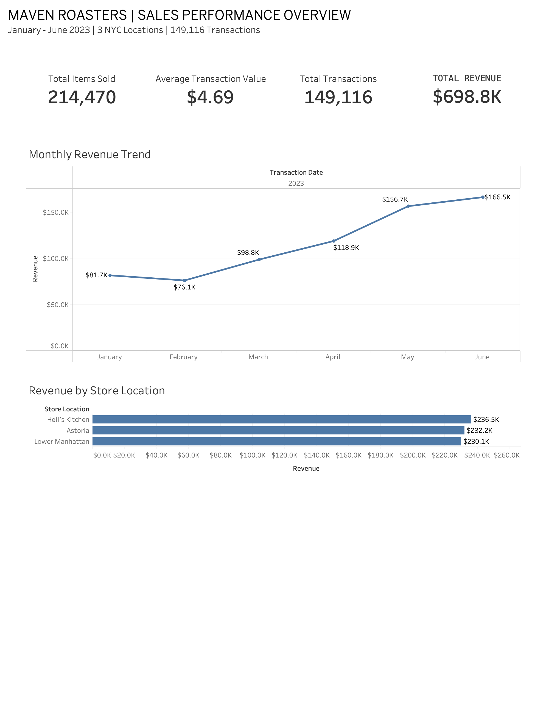

# Maven Roasters | Sales Performance Analysis

### SQL + Tableau Business Analytics Portfolio Project

## Project Overview

Analyzed 149,116 coffee shop transactions across three New York City locations from January through June 2023 to evaluate sales performance, revenue growth, product demand, and purchasing patterns.

The project combines MySQL data cleaning and business analysis with an interactive Tableau dashboard to translate transactional data into actionable business recommendations.

## Tools & Technologies

- **MySQL:** Data cleaning, exploratory analysis, aggregations, CTEs, and window functions
- **Tableau:** Interactive dashboards, calculated fields, KPI tracking, and data visualization
- **SQL:** Revenue analysis, product performance, store comparisons, and transaction trends

## Key Performance Indicators

| Metric | Value |
|---|---|
| Total Revenue | $698,812.33 |
| Total Transactions | 149,116 |
| Total Items Sold | 214,470 |
| Average Transaction Value | $4.69 |

## Key Findings

**1. Revenue Growth**

Revenue increased 103.8% between January and June 2023, driven primarily by increased transaction volume.

**2. Peak-Hour Demand**

Approximately 45.8% of revenue occurred between 7 AM and 10:59 AM, with 10 AM recording the highest transaction volume.

**3. Product Performance**

Coffee and tea collectively accounted for 66.7% of total revenue, making them the strongest product categories.

**4. Store Performance**

Hell's Kitchen generated the highest revenue at approximately $236.5K, followed by Astoria and Lower Manhattan.

## Business Recommendations

- Align staffing and inventory planning with peak morning demand.
- Monitor monthly transaction growth to support operational forecasting.
- Prioritize high-demand beverages and test complementary bakery promotions.
- Evaluate store-level performance to identify opportunities for operational improvements.

## Project Files

- `SQL/01_data_cleaning.sql` — Data preparation and SQL view creation
- `SQL/02_exploratory_analysis.sql` — Exploratory data analysis
- `SQL/03_business_analysis.sql` — Business performance queries
- `Dashboard/Maven_Roasters_Sales_Analysis.twbx` — Interactive Tableau workbook
- `Dashboard/Maven_Roasters_Sales_Performance_Final.pdf` — Three-page sales report

## Data Source

Maven Roasters coffee shop transaction dataset, covering January–June 2023 across three NYC locations.

## Project Objective

Demonstrate the ability to transform raw transactional data into business insights through SQL, data visualization, and actionable recommendations.
